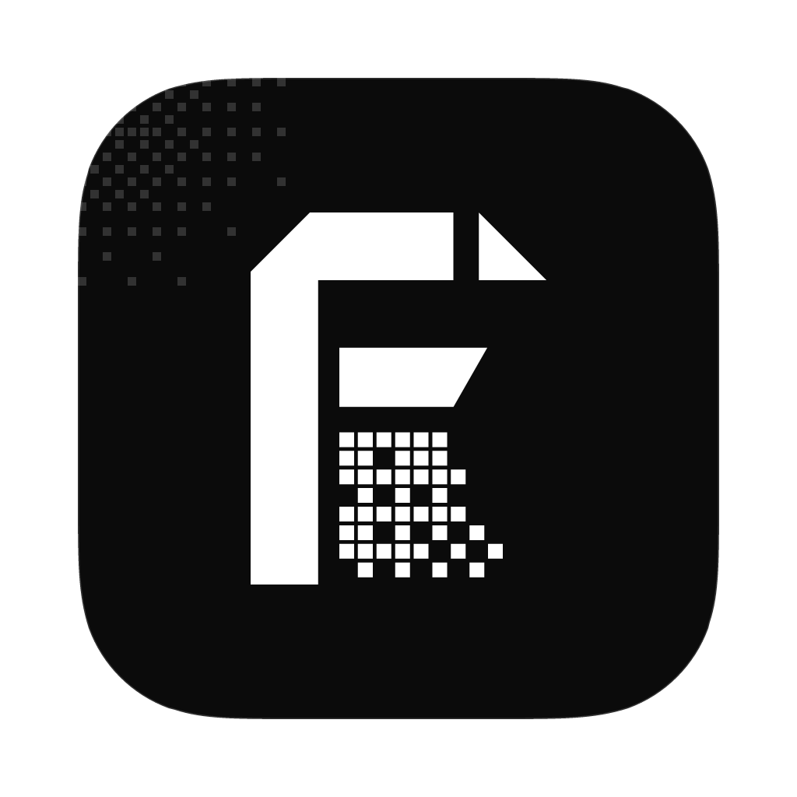

<p align="center">
  
</p>

<h1 align="center">folio</h1>

<p align="center"><strong>Documents, spreadsheets and slides in one file, drivable by your AI.</strong></p>

<p align="center"><strong>Status:</strong> Beta · v0.3.0 · Linux and macOS</p>

<p align="center">
  <a href="https://lsuite.xyz/folio">Website</a> ·
  <a href="https://lsuite.xyz/folio/download">Download</a> ·
  <a href="docs/AI_CONTROL.md">Documentation</a> ·
  <a href="CHANGELOG.md">Changelog</a>
</p>

<p align="center">
  
</p>

folio is an office app built on one idea: a file holds any mix of **documents** (rich text on
pages), **sheets** (a grid with formulas) and **decks** (slides), and they work together. A table
in a report or a chart on a slide can show a sheet's range **live**: change a number in the sheet
and the report and the slides follow. It opens and writes Word, Excel, PowerPoint and
OpenDocument files, and every action can be run by you, the built-in agent, a script or any MCP
client. It is a native Rust app, free and open source (MIT), and part of
[lsuite](https://lsuite.xyz), a suite of four free, open-source apps (kimchi, ryolune, nori and
folio).

## What it does

**Documents**
- Pages laid out exactly as they print (the window and the PDF share one layout engine)
- Paragraph styles (title, subtitle, three heading levels, quote, code, caption), bold, italic,
  underline, strikethrough, colour, highlight, size and font
- Bulleted, numbered and check lists with levels; alignment and justification
- Tables, pictures with captions, page breaks; page size and orientation, margins, headers and
  footers with page numbers
- Footnotes, comments with replies, tracked changes you accept or reject

**Sheets**
- A formula engine with references, ranges, other sheets (`'Raw data'!B2`), recalculation by
  dependencies and about 150 functions: SUM, AVERAGE, IF, IFS, VLOOKUP, XLOOKUP, INDEX, MATCH,
  COUNTIF(S), SUMIF(S), TEXT, DATE, EDATE, PMT, NPV…
- Number formats (currency, percent, dates, scientific…), bold, colours, fills, borders,
  alignment, wrap
- Sort, filter, fill down and right (series continue, formulas move their references), AutoSum
- Frozen headers, resizable columns and rows, charts over the grid

**Decks**
- Slide layouts (title, title and content, section, two columns, title only, blank) and themes
- Text boxes, rectangles, ellipses, triangles, lines and arrows; pictures; tables and charts
- Speaker notes, hidden slides; present full screen or with the presenter view (next slide,
  notes, clock)

**One file**
- Live tables and charts from any sheet range, in documents and on slides
- One undo history for everything, whoever made the change (you, the agent, a script)
- Saves itself; `.folio` is a zip of JSON and pictures ([FILE_FORMAT.md](docs/FILE_FORMAT.md))

**Coming from another office suite.** folio opens `.docx`, `.xlsx` and `.pptx` (also what
Google's apps download and what Pages, Numbers and Keynote export), `.odt`, `.ods`, `.odp`, CSV
and Markdown, and exports PDF, Office, OpenDocument, CSV, Markdown and HTML.

## Getting it

folio runs on **Linux** (x86_64: AppImage or `.deb`) and **macOS** (Apple Silicon and Intel;
signed and notarized).

**Download:** [lsuite.xyz/folio/download](https://lsuite.xyz/folio/download). folio comes through
the lsuite app, which installs and updates every lsuite app from its signed builds, with no
account.

Once installed, folio checks for updates through lsuite, verifies every download with its embedded
release key, and stages the update for the next restart (automatic installation is opt-in). The
macOS app and the AppImage update in place with a rollback copy; the `.deb` is updated by the
lsuite app.

### Building from source

Rust 1.92 or later. Linux needs GPUI's usual system libraries (the list is in
[`.github/workflows/ci.yml`](.github/workflows/ci.yml)).

```bash
cargo run -p folio                      # the window
cargo run -p folio-cli -- --help
scripts/bundle-linux.sh                 # the AppImage and the .deb
scripts/bundle-macos.sh                 # folio.app, a .dmg and the updater archive (on a Mac)
```

## Usage

Create a file (File › New, or from a template) and add document, sheet and deck pages to it, or
open an Office, OpenDocument, CSV or Markdown file (the original is never overwritten: export
writes it back). Every action in the
window is also a named command (`doc.write`, `sheet.setRange`, `deck.addSlide`…, see
[COMMANDS.md](docs/COMMANDS.md)), and the window, the built-in agent, `folio-cli` and
`folio-mcp` all go through the same registry and share one undo history.

### From AI and scripts

```bash
claude mcp add folio -- folio-mcp --live                                            # Claude Code
folio-cli file.overview                                                             # the running app
folio-cli --file plan.folio doc.write --markdown "# Plan\n\nShip on **Friday**."    # a file
folio-cli convert report.docx report.pdf
```

The **Agent** panel (Ctrl+J, ⌘J on macOS) runs the model you already have: Claude Code, Codex, an
Anthropic, OpenAI, OpenRouter, Gemini or Mistral key, or a local model (Ollama, LM Studio). Every
agent, the built-in one or yours over MCP, gets folio's harness: an office expert's brief, twelve
skills (a report from notes, a budget, a deck from a document…), the live state of the file before
every step, pictures of the pages, slides and sheets it made (`harness.look`) and objective checks
(`harness.check`) it runs before saying it is done. `folio-cli --file report.folio agent "…"` runs
the built-in agent without the window, and [`evals/`](evals) scores it on office jobs. Details:
[AI_CONTROL.md](docs/AI_CONTROL.md).

### Plugins

Ask the Agent panel for a plugin and it writes a spreadsheet function in Rust with folio's SDK
(`crates/folio-plugin`, see its [guide](crates/folio-plugin/GUIDE.md)), builds it and installs it.
The recipe agents follow is in [AI_CONTROL.md](docs/AI_CONTROL.md#plugins-written-by-an-agent).
Two examples are in [`examples/plugins`](examples/plugins): finance-extra and text-tools.

### With the rest of lsuite

`handoff.apps` lists the lsuite apps on this computer (from `~/.lsuite/apps`). `handoff.image
app=nori` brings in nori's open image and `handoff.image app=kimchi time=12` a frame of kimchi's
cut, as pictures in a document or on a slide. See
[AI_CONTROL.md](docs/AI_CONTROL.md#the-other-lsuite-apps).

## Documentation

- [docs/AI_CONTROL.md](docs/AI_CONTROL.md): the Agent panel, `folio-mcp`, `folio-cli`, permissions, plugins
- [docs/COMMANDS.md](docs/COMMANDS.md): every command, generated from the registry
- [docs/FILE_FORMAT.md](docs/FILE_FORMAT.md): the `.folio` file
- [crates/folio-plugin/GUIDE.md](crates/folio-plugin/GUIDE.md): writing a plugin
- [evals/RESULTS.md](evals/RESULTS.md): the agent evals and their results
- [CHANGELOG.md](CHANGELOG.md): what each release brought

## Project status and roadmap

folio is in **beta**: expect rough edges, and keep copies of files you care about. The current
version is 0.3.0. Ready-made builds are published for Linux and macOS; **Windows is coming soon**
(its code and packaging script stay in the source, but no Windows builds are published).

Known limitations:

- Named ranges are not supported: a formula that uses one shows `#NAME?`.
- Excel and OpenDocument sheets: merged cells are split, and conditional formatting, data
  validation, comments, pictures on sheets, pivot tables and macros are left out. ODS export
  leaves charts out (export XLSX to keep them).
- Word and OpenDocument text: floating pictures are placed in line, text boxes become paragraphs,
  and Word charts, SmartArt, shapes and metafile pictures are left out.
- PowerPoint: animations, transitions, SmartArt, videos and embedded objects are left out;
  unusual shapes become rectangles.
- folio writes PDF but cannot open it.
- A picture of the window (`ui.screenshot`) is available on macOS only.

Each format's full notes are listed by `file.formats` in the app and the CLI.

Next on the roadmap: Windows builds and named ranges.

## Contributing

Issues and pull requests are welcome on
[GitHub](https://github.com/ludovic111/folio/issues). A feature starts as a command in the
registry (`crates/folio-control`), so the window, the agent, the CLI and MCP get it together.
Before a pull request, run `cargo test --workspace` and
`cargo clippy --workspace --all-targets -- -D warnings`; after changing a command, regenerate
`docs/COMMANDS.md` with `cargo run -p folio-cli -- docs`.

```
crates/
  folio-calc      formula engine: parser, functions, number formats, dependency graph
  folio-core      the model: documents, sheets, decks, live links, one undo history, the .folio file
  folio-layout    text layout and pagination (cosmic-text), slide text, chart geometry, rasters
  folio-io        DOCX, XLSX, PPTX, ODF, CSV, Markdown, HTML and PDF
  folio-control   the command registry, session, permissions, loopback bridge, lsuite discovery, plugins
  folio-agent     the built-in agent
  folio-plugin    the plugin SDK (spreadsheet functions behind a frozen C ABI)
  folio-desktop   the window (GPUI), binary `folio`
  folio-cli       `folio-cli`: any command, on the running app or a file
  folio-mcp       `folio-mcp`: the registry as MCP tools (`--live`, `--file`)
  folio-release   signs update archives and writes latest.json for releases
```

Release builds are made by maintainers and published to lsuite's build store with
`scripts/publish-build.sh`; signing keys stay outside the repository.

## License

MIT. See [LICENSE](LICENSE). Fonts: IBM Plex and Chakra Petch (SIL Open Font License). Icons:
Lucide (ISC). Other apps' logos belong to their owners
([sources](crates/folio-desktop/assets/logos/SOURCES.md)).

folio is free, with no account and nothing to buy. If it helps you, you can
[support it](https://lsuite.xyz/folio/support) with an optional donation.

---

Made by [Ludovic Marie](https://lu4ovic.com) · [github.com/ludovic111](https://github.com/ludovic111)
